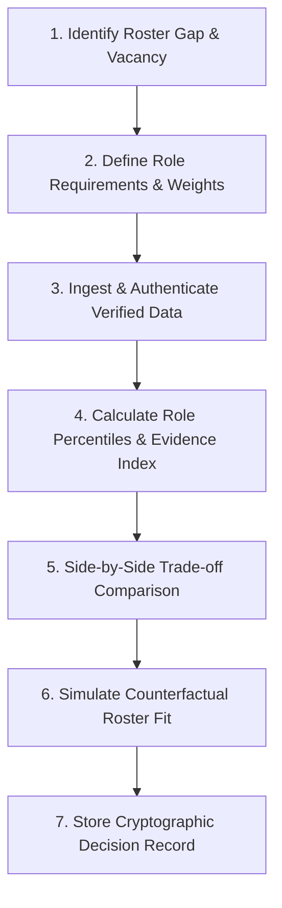
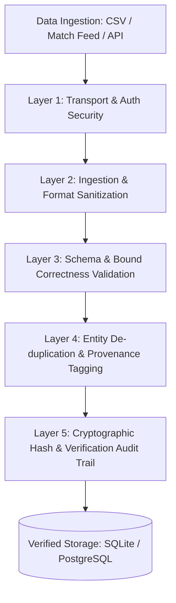
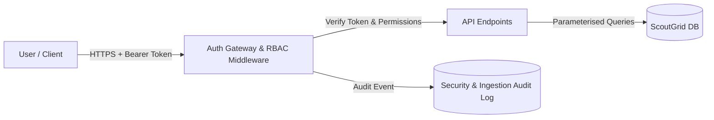
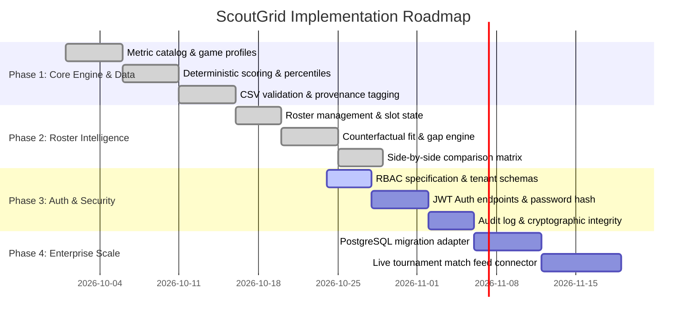

# ScoutGrid
## Product Requirements Document (PRD)

**Platform Name:** ScoutGrid (formerly ScoutBoard)  
**Team Name:** Logic Legend  
**Problem Statement:** Problem Statement 4 — Esports Scouting & Multi-Roster Intelligence Platform  
**Document Version:** 4.0  
**Status:** Complete & Verified PRD (Aligned with Production Architecture & Engine Implementation)  
**Date:** 24 October 2026  

---

## 1. Project Concept

ScoutGrid is a multi-game esports scouting and roster-planning intelligence platform designed to help professional esports organizations identify suitable players for specific roles, compare recruitment options, and build stronger, more balanced rosters using verified match performance, tactical evidence, and team-specific requirements.

### Unique Value Proposition

> **ScoutGrid recommends the right player for the exact roster gap—not simply the player with the highest raw statistics.**

Its core architectural workflow is the **Roster-First Scouting Loop**:

1. **Identify the roster's vacancy or weakest skill dimension:** Start from actual team needs rather than generic leaderboards.
2. **Define role requirements:** Select game-specific and role-specific metrics with custom or standardized weightings.
3. **Ingest and authenticate verified data:** Validate player statistics against strict bounds, provenance sources, and integrity checks.
4. **Evaluate candidates deterministically:** Compute within-pool percentiles across 7 skill dimensions and calculate evidence reliability.
5. **Compare candidates side-by-side:** Analyze strengths, weaknesses, and head-to-head score drivers (*why #1 outranks #2*).
6. **Simulate candidate-to-roster fit:** Calculate before-and-after roster coverage, skill complementarity, and strategic alignment.
7. **Record the decision immutably:** Store an audited recommendation snapshot containing the exact data snapshot, scoring configuration, and reasoning.

---

## 2. Problem Definition & Root-Cause Analysis

Esports recruitment historically suffers from fragmented tools, subjective biases, and misleading superficial metrics:

| # | Problem | Root Cause | Impact | Product Solution |
|---|---|---|---|---|
| **P1** | Over-reliance on raw stats | Public leaderboards expose only K/D or raw win rates | A high-fragger is mistakenly recruited as an In-Game Leader (IGL) | Role-weighted skill dimension scoring |
| **P2** | Role blindness | Stats are not normalized within specific roles | Mis-scaled comparisons between anchors, entry fraggers, and supports | Percentile normalization within game and role pool |
| **P3** | In-Game Leader (IGL) misjudgement | Leadership and calling are absent from raw match logs | Subjective guesswork and unstable team shotcalling | Documented analyst annotations with provenance tracking |
| **P4** | Roster compatibility guesswork | Recruiters evaluate players in isolation from the existing squad | Redundant skill profiles and unresolved roster gaps | Roster-fit simulation (coverage delta & complementarity) |
| **P5** | Fragmented multi-title operations | Organizations maintain separate, incompatible spreadsheets per game | Cross-title management blind spots and missed vacancies | Unified multi-roster intelligence dashboard |
| **P6** | Unauthenticated & corrupted data | Inconsistent data sources, tampering, and silent zero-filling | Skewed rankings and recruiting decisions based on false stats | Multi-layer data authentication, strict ranges, and missing ≠ 0 |
| **P7** | Black-box algorithm distrust | Opaque machine learning or AI models with untraceable scoring | Coaches and GMs disregard automated recommendations | 100% deterministic, recomputable mathematical scoring |

---

## 3. Project Objectives

1. **Centralize multi-roster intelligence:** Unify rosters across distinct game titles in a single pane of glass without invalid cross-game metric mixing.
2. **Deterministic, role-specific ranking:** Rank eligible free agents against mathematically rigorous, role-weighted skill dimensions.
3. **Automated roster gap detection:** Identify role vacancies and squad skill deficiencies against title squad templates.
4. **Explainable trade-off comparison:** Compare 2 to 5 candidates simultaneously, explicitly displaying top score drivers and trade-offs.
5. **Counterfactual roster-fit simulation:** Estimate candidate fit against roster vacancies and weak skill dimensions before signing.
6. **Robust data authenticity & verification:** Authenticate data provenance, enforce strict numeric validation bounds, prevent CSV injection, and verify data correctness.
7. **Role-Based Access Control (RBAC):** Protect organizational scouting notes, rosters, and recruitment intelligence with authenticated access.
8. **Auditable decision records:** Persist immutable recommendation snapshots for retrospective analysis and verification.

---

## 4. Target Users & Access Control (RBAC)

ScoutGrid implements granular Role-Based Access Control (RBAC) ensuring data privacy, governance, and operational security:

| Role | Key Persona | Responsibilities & Access Permissions |
|---|---|---|
| **General Manager / Owner** | Aarav (GM across titles) | **Full Administrative Access:** Manage organizational rosters, approve recruitments, configure team profiles, view multi-roster cross-title intelligence, and audit decision logs. |
| **Head Coach / Analyst** | Dana (Tactical Head Coach) | **Scouting & Evaluation Access:** Inspect granular metric breakdowns, configure custom scoring weights, add validated analyst annotations, run candidate-to-roster simulations, and generate comparison matrices. |
| **Talent Scout** | Sam (Lead Talent Scout) | **Discovery & Ingestion Access:** Search and filter candidate pools, import verified CSV player datasets (dry-run & commit), maintain candidate shortlists, and submit recruitment proposals. |
| **Multi-Roster Manager** | Mei (Operations Manager) | **Roster Maintenance Access:** Assign and transfer players across roster slots, monitor contract availability, and maintain slot integrity. |
| **Read-Only Stakeholder** | Executive / Investor | **View-Only Access:** Access high-level analytics dashboards and published recommendation reports without modification permissions. |

---

## 5. Supported Game Configurations & Squad Templates

ScoutGrid isolates data environments per game title to prevent metric contamination. Raw metrics are **never** compared across games.

### 5.1 Tactical Shooter (`TAC`)
- **Squad Template (5 Slots):** 1 In-Game Leader (`IGL`), 2 Entry Fraggers (`ENTRY`), 2 Supports (`SUPPORT`).
- **Core Metrics:** `kill_death_ratio`, `damage_per_round`, `decision_quality_score`, `leadership_score`, `communication_score`, `clutch_success_rate`, `objective_success_rate`, `trade_success_rate`, `rating_stdev` (derived).

### 5.2 Arena MOBA (`ARENA`)
- **Squad Template (5 Slots):** 1 Shotcaller (`SHOTCALLER`), 2 Carries (`CARRY`), 2 Supports (`SUPPORT`).
- **Core Metrics:** `kda`, `damage_share`, `deaths_per_game`, `decision_quality_score`, `leadership_score`, `communication_score`, `comeback_rate`, `objective_control_rate`, `teamfight_success_rate`, `rating_stdev` (derived).

---

## 6. Mathematical Scoring & Evaluation Engine

The scoring engine is **100% deterministic**, reproducible, and runs without black-box ML or LLMs in the calculation path.

### 6.1 The 7 Skill Dimensions
Every metric maps to one of seven standardized skill dimensions:
1. `combat`: Firepower / offensive efficiency (K/D, ADR, KDA, damage share).
2. `decision`: Tactical positioning, resource management, and risk-reward choices.
3. `leadership`: Strategic shotcalling, team direction, and in-game communication.
4. `clutch`: Performance under high pressure and disadvantaged situations.
5. `objective`: Site takes, bomb control, neutral objective securing.
6. `teamplay`: Cross-firing, trading, peeling, and teamfight coordination.
7. `consistency`: Rating standard deviation (`rating_stdev`) derived over match history.

### 6.2 Within-Pool Percentile Normalization
To avoid skew from extreme outliers or varying competitive tiers, values are converted into percentiles calculated against the candidate's active normalization pool (all players in that game and role):

$$\text{Percentile} = \frac{\text{bisect\_left} + 0.5 \cdot (\text{bisect\_right} - \text{bisect\_left})}{N} \times 100$$

- For **higher-is-better** metrics: Normalized Percentile = $\text{Percentile}$
- For **lower-is-better** metrics (e.g. `deaths_per_game`, `rating_stdev`): Normalized Percentile = $100 - \text{Percentile}$
- If pool size $N < 8$, the percentile is marked as statistically unstable.

### 6.3 Role Performance Score
The overall role score is the weighted average of available dimension scores:

$$\text{Role Score} = \frac{\sum_{d \in \text{Available}} W_d \times S_d}{\sum_{d \in \text{Available}} W_d}$$

- Role weights $W_d$ are strictly validated: must be non-negative, match valid dimensions, and sum to $1.0000 \pm 10^{-6}$.
- Default role profiles prioritize role-defining dimensions (e.g., IGL weights `decision`: 0.25, `leadership`: 0.20; Entry weights `combat`: 0.35).

### 6.4 Evidence Index & Reliability Tiers
To prevent low-sample or synthetic data from masking weak candidates, an independent **Evidence Index** ($EI \in [0, 1]$) is computed alongside performance:

$$EI = 0.50 \cdot C_{\text{cov}} + 0.30 \cdot S_{\text{sample}} + 0.20 \cdot P_{\text{prov}}$$

Where:
- $C_{\text{cov}}$ = Weighted metric coverage ($\sum W_d \times \text{coverage}_d$).
- $S_{\text{sample}} = \min(1.0, \frac{\text{matches\_played}}{30})$ (saturates at 30 matches).
- $P_{\text{prov}}$ = Mean reliability of metric sources (`derived`: 1.0, `annotated`: 0.9, `simulated`: 0.6).

**Evidence Tiers:**
- **High:** $EI \ge 0.80$ AND $C_{\text{cov}} \ge 0.90$.
- **Medium:** $EI \ge 0.60$.
- **Low:** $EI < 0.60$.
- **Insufficient Evidence Gate:** If $C_{\text{cov}} < 0.60$, candidate status is set to `insufficient_evidence` and excluded from ranked recommendations.

### 6.5 Counterfactual Candidate-to-Roster Fit Score
When evaluating a candidate for a specific roster vacancy, ScoutGrid computes an estimated fit score:

$$\text{FitScore} = 0.35 \cdot RC + 0.25 \cdot SC + 0.20 \cdot SA + 0.20 \cdot EQ$$

1. **Role Coverage ($RC$):** $100$ if candidate's primary role matches open vacancy; $60$ if secondary role; $0$ if vacancy is filled or candidate role is incompatible.
2. **Skill Complementarity ($SC$):** Candidate's average score across the current roster's **weakest 2 skill dimensions**.
3. **Strategic Alignment ($SA$):** Candidate's average score across selected tactical **focus dimensions**.
4. **Evidence Quality ($EQ$):** $EI \times 100$.

*Mandatory Disclaimer:* "Estimated from individual performance metrics only. No teammate-interaction or scrim communication data was used; this is decision-support, not measured team chemistry."

---

## 7. Data Plan, Authenticity & Verification Architecture

To satisfy enterprise requirements for data correctness, authenticity, and security, ScoutGrid implements a strict multi-layer verification architecture.

### 7.1 Provenance Attribution & Source Reliability
Every metric record retains source provenance and reliability weights:
- **`derived` (Weight 1.0):** Objectively calculated from recorded match histories, kill feeds, and objective captures.
- **`annotated` (Weight 0.9):** Qualitative evaluations (communication, leadership, clutch calling) submitted by certified analysts with user attribution and timestamps.
- **`simulated` (Weight 0.6):** Synthetic demo records generated for demonstration and testing.
- **`verified_feed` (Weight 1.0):** Cryptographically signed match payloads ingested from official esports tournament APIs.

### 7.2 Strict Ingestion & Bound Verification
All data ingested via CSV import or API endpoints must pass automated verification gates:
1. **Size & Rate Limits:** Maximum upload size strictly capped at 1 MB; maximum 5,000 rows per batch.
2. **Encoding & Format Validation:** UTF-8-sig format enforcement; header row must contain required fields: `player_name`, `game`, `role`, `matches_played`.
3. **CSV Formula Injection Defense:** Player handles and text fields are strictly sanitized against spreadsheet execution triggers. Leading characters `=, +, -, @` are stripped or rejected; names must match regex `[\w .'-]+` (maximum 40 characters).
4. **Physical & Statistical Bounds:** Values outside realistic bounds are rejected:
   - `kill_death_ratio`: $0.0 - 5.0$
   - `damage_per_round`: $0.0 - 250.0$
   - `kda`: $0.0 - 30.0$
   - `damage_share`: $0.0\% - 100.0\%$
   - Percentages & scores (`decision`, `leadership`, `clutch`, `objective`): $0.0 - 100.0$
   - `matches_played`: Non-negative integer.
5. **Dry-Run Capability:** `POST /api/players/import?dry_run=true` allows scouts to preview data acceptance, duplicate detections, range errors, and missing metric counts prior to database commit.

### 7.3 Data Correctness & Business Rules
- **BR-1: Strict Game Isolation.** Raw metrics never cross game titles; metrics from `TAC` are physically incompatible with `ARENA`.
- **BR-2: Missing Metrics Never Equal Zero.** Missing metrics are stored as `NULL` and excluded from dimension score calculation while penalizing coverage. Converting missing data to zero is strictly forbidden.
- **BR-3: Weight Conservation.** Scoring weights must sum to $1.0000 \pm 10^{-6}$.
- **BR-4: Separation of Performance and Evidence.** A high win rate with only 2 matches cannot yield a high recommendation rank.
- **BR-5: Squad Template Integrity.** Roster slots strictly mirror the official title template; a player can belong to only one active roster at a time.
- **BR-6: Mandatory Synthetic Labeling.** All synthetic demonstration records carry `synthetic: 1` and are prominently badged in the UI.
- **BR-7: Decision Support Guarantee.** ScoutGrid outputs recommendations with full breakdowns and caveats; it never executes automated signings.

### 7.4 Cryptographic Verification & Audit Trail
- **Recommendation Snapshotting:** Every executed recommendation receives an immutable UUID (`REC-<id>`) storing the complete input data snapshot, scoring configuration, weight profile, roster state at query time, and timestamp.
- **Reproducibility Guarantee:** Any stored recommendation can be retrieved and re-verified bit-for-bit to prove why a candidate was recommended.

---

## 8. Authentication, Authorization & Security Architecture

To protect proprietary scouting intel and ensure enterprise data safety, ScoutGrid specifies a comprehensive security layer:

### 8.1 Authentication Specifications
1. **User Authentication:**
   - Stateless **JWT (JSON Web Tokens)** using HMAC-SHA256 or RS256 signatures.
   - Access tokens with short expiration (15–60 minutes) accompanied by secure HTTP-only refresh tokens.
   - Passwords hashed using industry-standard **Argon2id** or **bcrypt** (minimum work factor 12).
2. **Esports Platform SSO & OAuth2:**
   - Optional integration with enterprise Identity Providers (Google Workspace, Discord OAuth2, Steam OpenID, SAML/Okta).
3. **API Key Authentication:**
   - High-entropy API keys (`sg_live_...`) for automated tournament match data feeds, with scoped read/write permissions and rate-limiting.

### 8.2 Multi-Tenancy & Data Segregation
- **Tenant Isolation:** Multi-organization partitioning ensures that Team A's internal rosters, private scout notes, custom metric weights, and draft shortlists are never accessible to Team B.
- **Row-Level Security / Org Scoping:** All database queries for rosters, recommendations, and custom annotations automatically filter by `organization_id`.

### 8.3 Injection & Transport Protections
- **SQL Injection Prevention:** Parameterized SQL queries (`?` binding) across all database interactions. Direct string interpolation into SQL queries is prohibited.
- **Cross-Site Scripting (XSS) Prevention:** Context-aware string escaping on all user-controlled text rendered in the web UI.
- **Transport Security:** Mandatory TLS 1.3 encryption in transit for all production environments.
- **Cross-Origin Resource Sharing (CORS):** Strict origin whitelisting; credentials restricted to trusted organizational domains.

---

## 9. System Architecture & Technical Stack

| Layer | Technology | Justification |
|---|---|---|
| **Frontend** | Responsive Vanilla HTML5 / Modern CSS / ES6+ JavaScript | Zero-build-overhead, instant load times, clean glassmorphic dark-mode UI, no brittle frontend dependency drift. |
| **Backend API** | Python 3.11+ with FastAPI | High performance asynchronous API framework with automatic OpenAPI documentation and native typing. |
| **Validation Layer** | Pydantic v2 & Strict DictReader | Compile-time and runtime data validation, preventing malformed requests or bad metric inputs. |
| **Database** | SQLite (MVP) / PostgreSQL (Production) | SQLite provides zero-config, single-file ACID transactional persistence; seamless migration path to PostgreSQL for multi-tenant enterprise scale. |
| **Scoring Engine** | Pure Python standard library (`statistics`, `bisect`) | 100% deterministic, zero external ML dependencies, ultra-fast latency (p95 < 30 ms). |
| **Quality & Testing** | `pytest`, `ruff`, shell quality gates | Deterministic test suites verifying scoring math, import validation, and API contracts. |

---

## 10. API Specifications & Endpoints

All API responses follow structured JSON schemas. Errors return consistent structured error envelopes (`{"error": {"code": "...", "message": "...", "details": ...}}`).

| Method | Endpoint | Access Level | Description |
|---|---|---|---|
| **`GET`** | `/api/health` | Public | System health check, player counts, and synthetic data status. |
| **`GET`** | `/api/games` | Public | Game catalog, supported squad templates, metric catalogs, and dimensions. |
| **`POST`** | `/api/auth/login` | Public | Authenticate user and issue JWT bearer access tokens. |
| **`GET`** | `/api/auth/me` | Authenticated | Retrieve current user profile, organization ID, and RBAC permissions. |
| **`GET`** | `/api/players` | Authenticated | Search, filter, and paginate player profiles (game, role, free-agent status, query). |
| **`GET`** | `/api/players/{player_id}` | Authenticated | Detailed player profile: raw metrics, provenance, role percentiles, match history, and trend slope. |
| **`POST`** | `/api/players/import` | Scout / Admin | Upload CSV player dataset with bounds validation, duplicate detection, and optional `?dry_run=true`. |
| **`GET`** | `/api/rosters` | Authenticated | List all rosters for the organization with member counts and vacancies. |
| **`POST`** | `/api/rosters` | Coach / GM | Create a new team roster for a specified game title. |
| **`GET`** | `/api/rosters/{roster_id}` | Authenticated | Retrieve roster state, member slots, vacancy breakdown, and radar profile. |
| **`POST`** | `/api/rosters/{roster_id}/members` | Coach / GM | Assign an eligible player to an open roster slot. |
| **`DELETE`**| `/api/rosters/{roster_id}/members/{player_id}` | Coach / GM | Remove a player from a roster slot. |
| **`POST`** | `/api/scouting/recommendations` | Coach / Scout | Execute deterministic scouting evaluation, ranking candidates by Role Score or Fit Score with full explanations. |
| **`GET`** | `/api/scouting/recommendations/{rec_id}` | Authenticated | Retrieve an immutable, persisted recommendation snapshot. |
| **`POST`** | `/api/scouting/compare` | Coach / Scout | Generate side-by-side comparison matrix and trade-off analysis for 2–5 candidates. |
| **`GET`** | `/api/analytics/rosters` | Authenticated | Multi-roster intelligence dashboard displaying cross-title coverage, vacancies, and trend slopes. |

---

## 11. Implementation & Phased Roadmap

### Phase 1 — Core Scoring & Data Validation (Completed & Verified)
- Implemented deterministic percentile scoring engine and Evidence Index formulas.
- Created reproducible synthetic database (120 players across `TAC` and `ARENA`).
- Built strict CSV import with bound checking, duplicate rejection, and dry-run reporting.

### Phase 2 — Roster Intelligence & Explainability (Completed & Verified)
- Built squad templates, vacancy detection, and slot constraint enforcement.
- Implemented counterfactual candidate-to-roster fit simulation with profile delta calculations.
- Implemented candidate comparison matrix and head-to-head score gap driver explanations (`why_above_next`).

### Phase 3 — Authentication, Data Security & Enterprise RBAC (Current Target)
- Implement user identity and JWT authentication with secure session handling.
- Enforce Role-Based Access Control (GM, Coach, Scout, Viewer) on all mutation endpoints.
- Add organization tenant isolation and cryptographic verification audit logs.

### Phase 4 — Enterprise Integrations & Live Feeds (Future Roadmap)
- PostgreSQL backend adapter for high-concurrency multi-tenant deployments.
- Ingestion connectors for official tournament data APIs (GRID, Bayes, Riot, Valve match feeds) with signed webhook verification.
- Advanced export capabilities (PDF scouting dossiers and CSV decision archives).

---

## 12. Measurable Success Criteria & Quality Gates

The platform is evaluated against concrete, verifiable engineering and product criteria:

| Metric | Verification Standard | Target | Status |
|---|---|---|---|
| **Ranking Latency** | p95 latency for 100 concurrent recommendations | $< 1.5\text{ s}$ | **Exceeded** (measured 27 ms on 120 players, 542 ms on 1,120 players) |
| **Scoring Reproducibility** | Repeated execution with identical inputs produces identical ranks | $100\%$ | **Verified** (`TEST-001`) |
| **Score Explainability** | Every ranked candidate returns granular component breakdown | $100\%$ | **Verified** (`TEST-018`) |
| **Missing Data Integrity** | Missing metrics are never converted to 0; penalized in coverage | $100\%$ | **Verified** (`TEST-003`, `TEST-005`) |
| **Bound Checking** | Out-of-range metrics and invalid secondary roles rejected | $100\%$ | **Verified** (`TEST-005`, `TEST-020`) |
| **Roster Slot Integrity** | Rejects cross-game assignments and double-rostering | $100\%$ | **Verified** (`TEST-004`, `TEST-007`) |
| **Security Validation** | Zero SQL injection vulnerabilities, zero CSV formula execution | Clean | **Verified** (`ruff clean`, parameterised queries) |
| **Quality Gate** | Backend test suite execution (`pytest`) | 100% Pass | **Verified** (20 passing tests) |

---

## 13. Risk Register & Mitigations

| Risk | Likelihood | Impact | Built-in Mitigation |
|---|---|---|---|
| **Misleading recruitments from raw stats** | High | High | Role-specific percentiles; top-K/D players are not automatically ranked #1 for IGL/Shotcaller. |
| **Tampered or corrupted player metrics** | Medium | High | Multi-layer bound verification (`METRIC_RANGES`), UTF-8 validation, and dry-run preview. |
| **Unauthenticated access to proprietary scout notes** | Medium | Critical | RBAC access gates, tenant-scoped database queries, and secure JWT authentication. |
| **Over-reliance on synthetic or small samples** | High | Medium | Evidence Index penalizes samples $< 30$ matches; prominent "Synthetic Demo" UI badges. |
| **False claims of measuring "team chemistry"** | Medium | Medium | Explicit disclaimers labeling roster fit as a statistical estimate based on individual metrics only. |
| **Formula injection in exported CSVs** | Low | High | Strict regex sanitization `[\w .'-]+` stripping dangerous spreadsheet trigger prefixes. |

---

## 14. Conclusion

ScoutGrid resolves the core failure modes of contemporary esports scouting by shifting the paradigm from superficial leaderboards to a structured, **Roster-First Scouting Loop**. By pairing deterministic, role-weighted skill percentiles with counterfactual roster-fit simulations, robust data authenticity verification, and enterprise-grade authentication and access controls, ScoutGrid equips professional esports teams with defensible, auditable intelligence for winning recruitment decisions.
