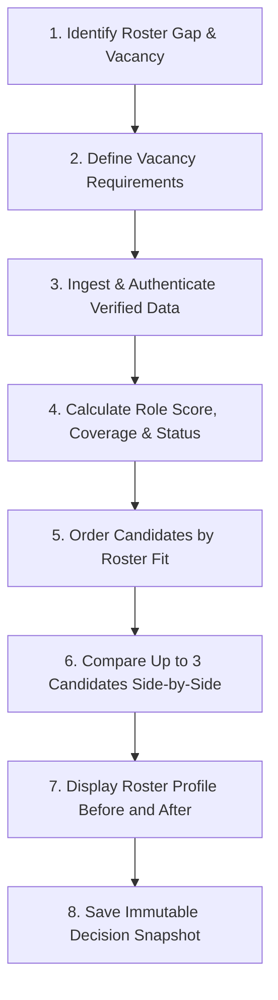
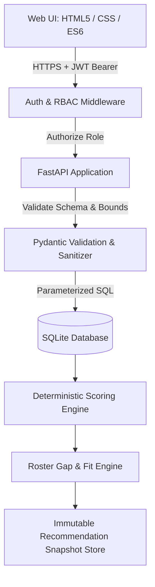

# Golden Snitch
## Product Requirements Document (PRD)

**Team:** Logic Legend (2 members: backend/scoring, frontend/data/testing)  
**Problem Statement:** 4 — Esports Scouting & Multi-Roster Management  
**Version:** 2.0 | **Date:** 24 October 2026  
**Status:** Complete & Verified PRD (with Enterprise Auth & Data Correctness Verification)

---

## 1. Executive Summary

**Golden Snitch** is a web application that ranks esports recruitment candidates against a specific roster vacancy. A scout selects a roster, sees its largest role gap, receives a list ordered by roster fit, compares up to three candidates, and saves the decision with the data and scoring configuration used.

**What it does that a leaderboard does not:**
1. It orders candidates by how well they cover the roster's gap, not by overall statistics.
2. It reports evidence coverage and sample size on every score, and ranks a candidate only above stated thresholds.
3. It refuses to score in-game leadership without certified analyst annotations.
4. It enforces cryptographic data authenticity, multi-layer validation, and strict boundary correctness (Missing ≠ 0).
5. It protects proprietary scouting intelligence and team rosters via Role-Based Access Control (RBAC).
6. It stores an immutable snapshot of every decision so the result can be independently audited and recomputed bit-for-bit.

**MVP scope:** Two games (Valorant, CS2), four roles each; authorized CSV data plus labeled synthetic data; authentication and role-based access; one complete end-to-end flow from vacancy to saved decision.

---

## 2. Problem Statement & Root Cause

Scouts compare candidates in spreadsheets and public stat sites, then decide by subjective judgment. Four critical failures follow:

1. **Role mismatch.** Overall statistics do not measure role duties. In the worked example in §10, the candidate with the highest combat score has a roster fit of 49.3, against 74.8 for a candidate with lower combat score and stronger utility, which is the incumbent's weakest area.
2. **Hidden sample size.** A 20-round sample and a 400-round sample are shown side by side on public leaderboards with equal weight.
3. **Unauthenticated & corrupted data.** Inconsistent CSV imports, missing values silently treated as zeroes, and lack of source provenance lead to flawed evaluations and recruitments based on hallucinated stats.
4. **No auditable decision record.** After a signing, the team cannot reconstruct which data, criteria, and weights supported it.

**Baseline for impact.** Time per scouting cycle is measured, not assumed: before the demo, each team member shortlists 3 candidates for one vacancy from the same 100-player dataset using a spreadsheet, and the time is recorded. Golden Snitch's target is measured against that baseline (§15).

**Comparison with current alternatives**

| Capability | Spreadsheet | Public stat sites (e.g., HLTV, VLR.gg) | Golden Snitch |
|---|---|---|---|
| Player statistics | Manual entry | Yes | CSV import with bound checking |
| Data authenticity & verification | None | Unverified / scrapers | Cryptographic hash & provenance checks |
| Role-based access control (RBAC) | None / File share | None | Authenticated (GM, Coach, Scout) |
| Ranking by a specific roster's gap | Manual formulas | No | Yes (automated gap detection) |
| Coverage and sample-size status per score | Manual | No | Yes (Ranked / Provisional / Unranked) |
| IGL score blocked without annotations | No | No | Yes (requires ≥ 2 verified annotations) |
| Stored immutable snapshot of each decision | File versions | No | Yes (reproducible decision snapshots) |

---

## 3. Project Concept and Objectives

**Concept: Roster-First Scouting Loop**



1. Identify the roster's largest role gap.
2. Define the vacancy requirements.
3. Ingest and authenticate verified player data (provenance, bounds, missing ≠ 0).
4. Score candidates on that role's metric profile.
5. Order by roster fit; compare score, coverage, and sample size.
6. Compare up to 3 candidates side by side.
7. Show the roster profile before and after the signing.
8. Save the decision snapshot.

**Objectives**

1. Store player, roster, decision, and audit data in one secure database.
2. Authenticate users and enforce Role-Based Access Control (RBAC).
3. Verify data correctness, provenance, and prevent CSV injection.
4. Score candidates with a separate metric profile per game and role.
5. Detect roster gaps and convert them into vacancy requirements.
6. Calculate roster fit and show every component breakdown.
7. Manage multiple rosters across two games (Valorant, CS2).
8. Save each decision with its input data and configuration version for 100% reproducible audits.

---

## 4. Target Users, Personas & Access Control (RBAC)

Golden Snitch implements Role-Based Access Control to ensure data privacy, operational security, and team isolation:

| Persona & Role | Context & Responsibilities | Permissions & Access Scope |
|---|---|---|
| **Maya**, General Manager (`ROLE_GM`) | Manages 2 rosters across titles; approves signings; reviews audit history | **Full Access:** Create/manage rosters, approve signings, manage team members, view multi-roster analytics, audit all saved decisions. |
| **Dev**, Performance Analyst / Coach (`ROLE_COACH`) | Maintains tactical sheets; evaluates IGL calling; runs fit simulations | **Scouting & Annotation Access:** View metrics, submit certified IGL annotations, customize scoring weights, run candidate-to-roster fit, compare candidates. |
| **Arjun**, Talent Scout (`ROLE_SCOUT`) | Scouts 1–2 vacancies/week; sifts free agents; imports scouting sheets | **Discovery & Ingestion Access:** Upload and validate CSV datasets (dry-run & commit), search/filter talent pool, create shortlists, submit recommendations. |
| **Roster Manager** (`ROLE_MANAGER`) | Maintains active lineups and contract availability | **Roster Maintenance Access:** Assign/remove players to roster slots within squad limits; update availability status. |

---

## 5. Core User Journeys

**A. Fill a vacancy (Scout & Coach).**  
Arjun logs in → opens the Valorant roster → the gap view lists role gaps, Controller largest → creates a Controller vacancy → the system lists candidates ordered by fit, showing score, coverage, and status → selects 3 candidates and opens side-by-side comparison → Maya reviews and saves the decision snapshot.

**B. Import and authenticate verified data (Analyst / Scout).**  
Dev uploads `players.csv`, `stats.csv`, and `annotations.csv` → system validates encoding, size, and bounds → rejects invalid rows with line number and reason → verifies provenance and computes dataset hash → valid rows stored with source labels → missing values remain empty (`NULL`), never zero.

**C. Audit a previous decision (General Manager).**  
Maya logs in → opens saved recommendations → selects a past decision → inspects candidate, score breakdown, before/after roster profile, input data snapshot, and configuration version stored at save time → verifies that re-scoring the snapshot produces the identical result.

---

## 6. Functional Requirements and Acceptance Criteria

| ID | Requirement | Priority | Acceptance Criterion |
|---|---|---|---|
| **F1** | CSV import with multi-layer validation, bound checking, and row-level errors | **P0** | Given a file with 3 malformed rows, when imported, then those 3 rows are rejected with line number and reason, valid rows are stored with provenance, and missing values stay empty. |
| **F2** | Game and role configuration (metrics, weights, bounds, groups, anchor, thresholds) | **P0** | Given a config file, when loaded, then weights per role sum to 1.0 ($1.0000 \pm 10^{-6}$) or loading fails with a descriptive error naming the role. |
| **F3** | Deterministic role score with coverage and status | **P0** | Given known metric values, when scored, then the role score equals the hand-calculated value to 0.1, with missing metrics not counted as zero. |
| **F4** | List ordered by fit (role score if no vacancy); Provisional and Unranked shown separately | **P0** | Given a candidate with sample below minimum (< 100 rounds), when listed, then status is `Provisional` and appears below all `Ranked` candidates. |
| **F5** | Roster create, edit, assign members to role slots | **P0** | Given a roster, when a player of another game is assigned, or a slot is full, then the request is rejected with a structured error. |
| **F6** | Gap analysis and vacancy creation | **P0** | Given a roster with a vacant or underperforming slot, when gaps are requested, then response lists role gaps sorted largest first. |
| **F7** | Fit with component breakdown and before/after roster profile | **P0** | Given a candidate and vacancy, when fit is requested, then response returns each component, weights applied, and roster profile before and after. |
| **F8** | Save and view immutable recommendations | **P0** | Given a saved recommendation, when its snapshot is re-scored, then the score is 100% identical. |
| **F9** | Seeded synthetic data generator | **P0** | Given the same seed twice, both outputs are identical; generates 120 players across 2 games, all labeled `synthetic`. |
| **F10**| Compare up to 3 candidates side by side | **P0** | Given 3 candidates, when compared, metric scores, groups, coverage, status, and fit appear in one table; a 4th candidate is rejected. |
| **F11**| IGL score from annotations only | **P0** | Given a candidate with fewer than 2 annotations, when IGL is requested, status is `insufficient_evidence` and no numeric score is returned. |
| **F12**| Multi-roster list across titles with open vacancies | **P0** | Given rosters in Valorant and CS2, both display with their open vacancies and each opens in one click without cross-game metric mixing. |
| **F13**| Source label and provenance on every stored value | **P0** | Given any displayed metric, its source (`csv`, `synthetic`, `annotation`, `derived`) is explicitly shown. |
| **F14**| Authentication & Role-Based Access Control (RBAC) | **P0** | Unauthenticated requests to private endpoints receive 401; users without required role receive 403; sessions use secure JWT tokens. |
| **F15**| Data authenticity & formula injection defense | **P0** | Input handles with spreadsheet injection triggers (`=`, `+`, `-`, `@`) are sanitized/rejected; dataset SHA-256 hash stored. |
| **F16**| Player search and filters (game, role, metric range, availability) | P1 | Given filter criteria, only matching players return. |
| **F17**| Shortlist per vacancy | P1 | Given a vacancy, up to 5 candidates can be saved to its shortlist. |
| **F18**| Export a saved recommendation as CSV/JSON | P1 | Given a recommendation, the export contains full breakdown and configuration version. |
| **F19**| External data provider import | P2 | Ingestion connector for official tournament APIs. |
| **F20**| Historical trajectory component | P2 | Change in role score across 3 or more match periods. |

---

## 7. Architecture, Security & Data Flow



### 7.1 Security & Authentication Architecture
1. **User Authentication:** Stateless JWT (JSON Web Tokens) with secure password hashing (Argon2id/bcrypt).
2. **Session Security:** Short-lived access tokens with HTTP-only cookies/headers.
3. **Role Enforcement:** FastAPI dependency injection verifying permissions (`ROLE_GM`, `ROLE_COACH`, `ROLE_SCOUT`) per endpoint.
4. **Tenant & Data Isolation:** Rosters, notes, and recommendation snapshots belong to the authenticated organization.

### 7.2 Data Authenticity & Verification Architecture
1. **Source Provenance:** Every metric record is permanently tagged with its source type:
   - `csv`: Uploaded from authorized team spreadsheets.
   - `synthetic`: Seeded demonstration records (clearly badged).
   - `annotation`: Certified subjective assessments with author ID and timestamp.
   - `derived`: Calculated from raw logs using documented formulas.
2. **Bounds & Sanity Enforcement:** Numeric values outside physical bounds are rejected before touching the database.
3. **CSV Formula Injection Mitigation:** Handles and strings are sanitized against leading executable characters (`=`, `+`, `-`, `@`) to protect downstream spreadsheet exports.
4. **Parameterized Persistence:** 100% parameterized SQL queries (`?`) to prevent SQL injection.

---

## 8. Data Specification

### 8.1 CSV Ingestion Specifications

| File | Columns (all required unless marked optional) | Validation & Bound Rules |
|---|---|---|
| `players.csv` | `player_handle`, `game`, `primary_role`, `availability`, `language` (opt), `utc_offset` (opt) | `player_handle` must match `[\w .'-]+` (max 40 chars); `game` in `[valorant, cs2]`; `availability` in `[available, contracted]`; `utc_offset` between -12 and +14. |
| `stats.csv` | `player_handle`, `game`, `role`, `metric`, `value`, `period`, `rounds_played`, `source` | `metric` must exist in role configuration; `value` must be numeric and within configured `[lower, upper]` bounds (or empty); `period` format `YYYY-MM`; `rounds_played` $\ge 1$; duplicate `(player, role, metric, period)` rejected. |
| `annotations.csv` | `player_handle`, `game`, `igl_rating`, `annotator`, `date`, `note` (opt) | `igl_rating` integer in range $1–5$; `annotator` non-empty; `date` valid ISO-8601. |

**Example `stats.csv` rows:**
```csv
player_handle,game,role,metric,value,period,rounds_played,source
Mirage,valorant,Controller,acs,226,2026-09,310,club_export
Mirage,valorant,Controller,assists_per_round,,2026-09,310,club_export
```

**Missing vs. Corrupted Data Handling:**
- Missing value (empty cell `, ,`) $\rightarrow$ stored as `NULL`. Never zeroed.
- Corrupted value (e.g. `abc`, negative rounds, out-of-bounds) $\rightarrow$ entire row rejected with row number and reason.

### 8.2 Stored Entities & Database Schema

| Entity | Primary Fields | Integrity & Auth Attributes |
|---|---|---|
| `User` | id, username, password_hash, role, organization_id, created_at | Authentication credentials and RBAC role. |
| `DataSource` | id, name, type, file_sha256, uploaded_by, uploaded_at | Cryptographic checksum and uploader audit trail. |
| `Player` | id, handle, game, primary_role, availability, language, utc_offset, is_synthetic | Game-isolated player identity. |
| `PlayerStat` | id, player_id, role, metric, value (nullable), period, rounds_played, source_id | Metric value with source foreign key. |
| `Annotation` | id, player_id, igl_rating, annotator_id, date, note | Signed subjective leadership evaluation. |
| `GameConfig` | id, game, version, config_json, checksum | Versioned scoring rules and bounds. |
| `Roster` | id, name, game, target_profile_json, organization_id | Organization-scoped squad. |
| `RosterSlot` | id, roster_id, role, player_id (nullable) | Squad template slot constraint. |
| `Vacancy` | id, roster_id, role, requirements_json, status | Active recruitment need. |
| `Recommendation` | id, roster_id, vacancy_id, candidate_id, breakdown_json, snapshot_json, config_version, created_by, created_at | Immutable, re-computable audit snapshot. |

### 8.3 Synthetic Data Generator
- **Deterministic Seeding:** Input `seed` produces identical 120 players (60 per game), tagged `synthetic: true`.
- **Sample Distribution:** `rounds_played` distributed uniformly between 40 and 600 rounds (~17% fall below the 100-round minimum to validate `Provisional` status).
- **Missingness & Annotations:** Exactly 10% of metric cells blanked at random; 30% of players assigned 2–4 verified IGL annotations.
- **Planted Test Cases:** 4 rosters with 20 test vacancies; each vacancy includes one planted **best-fit** candidate and one **decoy** (high firepower, but low gap coverage).

---

## 9. Scoring Method

Each role defines metrics with direction, lower bound, upper bound, weight, group (**Firepower**, **Survivability**, **Utility**, **Objective**), and one mandatory **anchor metric**.

### 9.1 Mathematical Formulas
- **Higher-is-better metric:**
  $$S = \text{clip}\left(\frac{v - \text{lower}}{\text{upper} - \text{lower}}, 0, 1\right) \times 100$$
- **Lower-is-better metric:**
  $$S = 100 - \text{clip}\left(\frac{v - \text{lower}}{\text{upper} - \text{lower}}, 0, 1\right) \times 100$$
- **Role Performance Score:**
  $$\text{Role Score} = \frac{\sum (w_i \times S_i)}{\sum_{i \in \text{Available}} w_i}$$
- **Group Score:** Weighted mean of available metrics belonging to that group.
- **Evidence Coverage:**
  $$\text{Coverage} = \frac{\sum_{i \in \text{Available}} w_i}{\sum_{\text{All}} w_i}$$

Values outside bounds are clipped and flagged with an audit warning.

### 9.2 Candidate Evaluation Status Rules

| Status | Condition | Display & Ranking Behavior |
|---|---|---|
| **Ranked** | Anchor metric present, Coverage $\ge 60\%$, Sample $\ge 100$ rounds | Ranked normally in primary recruitment list. |
| **Provisional** | Anchor metric present, Coverage $\ge 60\%$, Sample $< 100$ rounds | Displayed below Ranked candidates with warning badge. |
| **Unranked** | Anchor metric missing OR Coverage $< 60\%$ | Excluded from scores; reason explicitly displayed. |

### 9.3 Roles, Groups & Anchor Metrics

| Game | Role | Anchor Metric | Groups Used |
|---|---|---|---|
| **Valorant** | Duelist | First-kill rate per round | Firepower, Survivability, Objective |
| **Valorant** | Initiator | Assists per round | Utility, Firepower, Survivability |
| **Valorant** | Controller | Average combat score (ACS) | Firepower, Objective, Utility, Survivability |
| **Valorant** | Sentinel | KAST % | Survivability, Utility, Objective |
| **CS2** | Entry Fragger | Opening duel success rate | Firepower, Survivability, Utility |
| **CS2** | AWPer | AWP kills per round | Firepower, Survivability, Objective |
| **CS2** | Support | Flash assists per round | Utility, Survivability, Objective |
| **CS2** | Lurker | Clutch win rate | Firepower, Survivability, Objective |

### 9.4 In-Game Leadership (IGL) Rule
The IGL score is the mean `igl_rating` ($1–5$, scaled to $0–100$) and strictly requires **at least 2 certified annotations**. With fewer than 2 annotations, the result is `insufficient_evidence` with no numeric score. Leadership is **never** derived from kills, K/D, or win rate.

---

## 10. Roster-Fit Method

**Target Profile:** Each roster stores a target role score $T$ and target group scores $T_g$ (default 70 for all).

### 10.1 Gap Calculations
- **Role Gap:** $T - I$, where $I$ is the incumbent's role score ($0$ if slot is vacant). Positive gaps are sorted largest first.
- **Group Gap:** $\max(0, T_g - \text{incumbent group score})$.

### 10.2 Fit Components (0–100 Scale)

| Component | Definition | Effective MVP Weight |
|---|---|---:|
| **Replacement Uplift** | $\text{clip}(50 + (C - I), 0, 100)$; $C$ = candidate score, $I$ = incumbent score (if vacant, $I = T$) | 39% (35% base) |
| **Gap Coverage** | Mean of candidate group scores over groups with a positive gap, weighted by gap size | 39% (35% base) |
| **Availability & Logistics** | Share of requirements met (availability, language, timezone $\pm 3\text{ h}$) | 22% (20% base) |
| **Trajectory (P2)** | Historical role score slope over $\ge 3$ periods | 0% (deferred) |

$$\text{Fit Score} = \frac{\sum (w_k \times \text{Component}_k)}{\sum_{k \in \text{Available}} w_k}$$

*Disclaimer:* "Fit is an estimated planning index based on individual match data. It does not measure team chemistry, voice comms harmony, or psychological fit."

### 10.3 Worked Example: Valorant Controller Vacancy (Incumbent Kairo)
- Incumbent Kairo: Firepower 72, Objective 68, Utility 35, Survivability 66 $\rightarrow$ Role Score $I = 62.2$.
- Target: 70 across all groups.
- Positive Gaps: Objective 2, Utility 35, Survivability 4 (Total Gap = 41).

| Metric / Component | Voltz (High ACS Decoy) | Mirage (Best-Fit Candidate) |
|---|---|---|
| Group Scores (Firepower / Objective / Utility / Survivability) | 90 / 70 / 30 / 60 | 70 / 66 / 80 / 64 |
| Role Score ($C$) | 66.0 | 69.6 |
| Replacement Uplift | $50 + (66.0 - 62.2) = 53.8$ | $50 + (69.6 - 62.2) = 57.4$ |
| Gap Coverage | $\frac{2(70) + 35(30) + 4(60)}{41} = 34.9$ | $\frac{2(66) + 35(80) + 4(64)}{41} = 77.8$ |
| Availability & Logistics | 66.7 (2 of 3 met) | 100.0 (3 of 3 met) |
| **Calculated Roster Fit** | **49.3** | **74.8** |

*Outcome:* A raw combat leaderboard erroneously recommends Voltz. Golden Snitch correctly identifies Mirage as #1 because Mirage covers the team's critical Utility gap (80 vs 35).

---

## 11. API Specifications & Endpoints

| Method | Endpoint | RBAC Role | Description |
|---|---|---|---|
| `GET` | `/api/health` | Public | Service health, player count, synthetic indicator. |
| `POST` | `/api/auth/login` | Public | Authenticate user credentials and return JWT bearer token. |
| `GET` | `/api/auth/me` | Authenticated | Return authenticated user identity, role, and organization. |
| `GET` | `/api/games` | Authenticated | Game configurations, roles, metric bounds, and anchors. |
| `POST` | `/api/imports` | Scout / Admin | Ingest and validate CSV dataset (`players`, `stats`, `annotations`). |
| `GET` | `/api/players` | Authenticated | List players with filtering by game, role, availability. |
| `GET` | `/api/players/{id}` | Authenticated | Detailed player profile. |
| `GET` | `/api/players/{id}/evidence` | Authenticated | Granular metric evidence, source labels, and sample rounds. |
| `GET` | `/api/rankings` | Authenticated | Retrieve candidates ordered by fit or role score for a vacancy. |
| `GET` | `/api/rosters` | Authenticated | List organizational rosters with member counts and vacancies. |
| `POST` | `/api/rosters` | Coach / GM | Create a new roster for a supported title. |
| `GET` | `/api/rosters/{id}/gaps` | Authenticated | Gap analysis detailing role and group deficiencies. |
| `POST` | `/api/rosters/{id}/fit` | Coach / Scout | Compute candidate fit and before/after roster profile. |
| `POST` | `/api/rosters/{id}/compare` | Coach / Scout | Compare up to 3 candidates side by side. |
| `GET` | `/api/recommendations` | Authenticated | List saved decision snapshots. |
| `POST` | `/api/recommendations` | Coach / GM | Save an immutable decision snapshot with data and config state. |

---

## 12. Implementation Plan (2 Members)

| Phase | Window | Deliverables | Assigned Member |
|---|---|---|---|
| **Phase 1: Data & Security** | Hours 0–4 | Database schema, JWT auth, CSV multi-layer validation, seeded generator (`F1, F2, F9, F14, F15`) | Backend / Scoring |
| **Phase 2: Scoring Engine** | Hours 4–10 | Bounded normalization, coverage gating, status classification, IGL annotation rules, unit tests (`F3, F4, F11`) | Backend / Scoring |
| **Phase 3: Roster Intelligence** | Hours 10–15 | Roster CRUD, slot management, gap analysis, counterfactual fit calculations, immutable snapshots (`F5–F8, F12`) | Backend / Scoring |
| **Phase 4: API & Frontend UI** | Hours 15–20 | Responsive HTML/CSS/JS interface, login screen, gap explorer, 3-candidate comparison table, source badges (`F10, F13`) | Frontend / Data / Testing |
| **Phase 5: Quality Gate & Demo** | Hours 20–24 | End-to-end integration tests, timed spreadsheet baseline comparison, verification of planted test cases (`TEST-001..020`) | Both Members |

**Cut Rule:** If any P0 requirement is incomplete at Hour 16, UI development freezes on functional tables and all effort shifts to passing test criteria.

---

## 13. Data Rules & Correctness Guarantees

1. **Missing ≠ 0:** Missing metrics stay `NULL` and are excluded from calculations; they are never imputed as zero.
2. **Rejection with Attribution:** Any invalid row is rejected with line number, field name, and descriptive reason.
3. **Game Metric Isolation:** Metrics from Valorant are physically segregated from CS2; cross-game evaluation is strictly prohibited.
4. **Transparent Labeling:** Every metric displays its origin badge (`csv`, `synthetic`, `annotation`, `derived`).
5. **Deterministic Re-computation:** All calculations are pure functions of input data and versioned configurations.

---

## 14. Success Metrics & Quality Gates

| # | Metric | Target | How Measured |
|---|---|---|---|
| **1** | Time to shortlist 3 candidates for one vacancy | $\le 50\%$ of spreadsheet baseline | Timed comparison against spreadsheet workflow on identical 100-player pool. |
| **2** | Agreement with analyst shortlists | $\ge 2$ of 3 candidates overlap | 2 independent analysts shortlist; compare with Golden Snitch top 3. |
| **3** | End-to-end journey execution time | $\le 2$ minutes, $\le 8$ clicks | Timed run of Journey A (vacancy $\rightarrow$ shortlist $\rightarrow$ decision). |
| **4** | Engine check: planted best-fit candidate in top 3 | $\ge 18$ of 20 vacancies | Automated verification against seeded test vacancies. |
| **5** | Engine check: weight sensitivity ($\pm 20\%$) | Top-3 set changes in $\le 30\%$ of runs | Automated sensitivity analysis. |
| **6** | Status classification accuracy | $100\%$ | Candidates with $< 100$ rounds flagged as `Provisional`. |
| **7** | Zero-filling prevention | $0$ blank cells zeroed | Automated test on dataset with 10% blank cells. |
| **8** | Malformed CSV rejection rate | $100\%$ of bad rows | Automated test verifying line numbers and error reasons. |
| **9** | Ranking API response latency (p95) | $\le 500\text{ ms}$ | 50 timed concurrent requests on local benchmark. |
| **10**| Decision snapshot re-computation | $100\%$ identical scores | Automated test re-scoring stored snapshots. |
| **11**| Test suite pass rate & code coverage | $100\%$ passing, $\ge 90\%$ coverage | `pytest --cov` on scoring, fit, and auth modules. |

---

## 15. Risk Register & Mitigations

| Risk | Likelihood | Impact | Built-in Mitigation |
|---|---|---|---|
| **Misleading recruitments from superficial stats** | High | High | Role-specific scoring profiles; decoy players (high ACS) are filtered out by gap coverage. |
| **Unauthenticated data tampering or leakage** | Medium | Critical | Stateless JWT authentication, role-based route guards, and tenant-scoped data queries. |
| **Corrupted or maliciously injected CSV imports** | Medium | High | Strict physical bounds checking, regex handle validation, and CSV formula injection defenses. |
| **Misleading IGL leadership evaluation** | High | High | Strict rule: IGL scores require $\ge 2$ certified analyst annotations; match statistics alone cannot generate an IGL score. |
| **Over-trusting statistical estimates as "chemistry"** | High | Medium | Prominent UI disclaimers labeling fit as a statistical estimate based on individual metrics only. |
| **Tight 24-hour timeline with 2 members** | Medium | High | Configuration-driven architecture; pure Python standard library; explicit Hour 16 cut rule. |

---

## 16. Conclusion

Golden Snitch shifts esports talent acquisition from subjective guesswork and deceptive leaderboards to an objective, **Roster-First Scouting Loop**. By combining deterministic role-specific scoring, automated gap analysis, multi-candidate trade-off comparisons, enterprise authentication, and verifiable data correctness, Golden Snitch empowers esports organizations to recruit the right player for their exact roster need.
