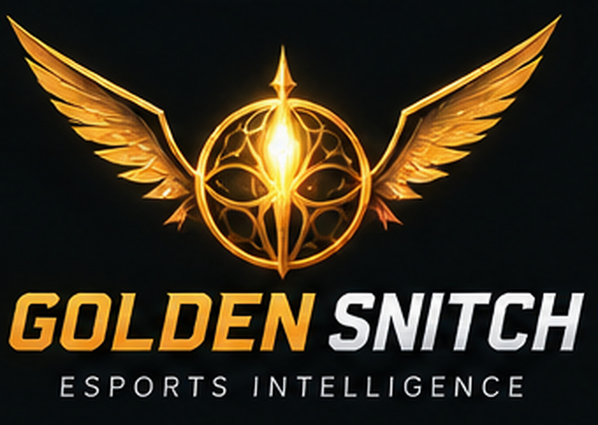
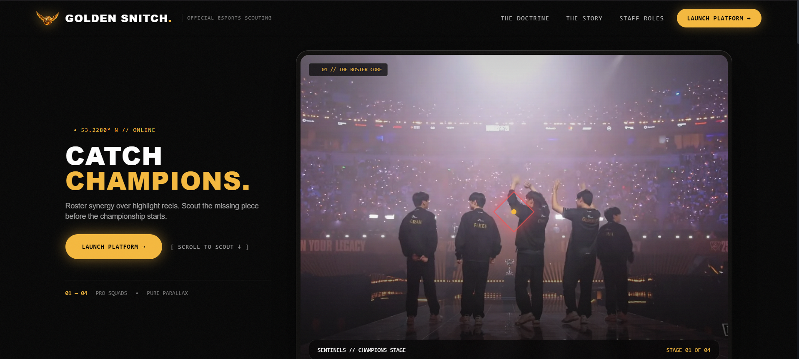
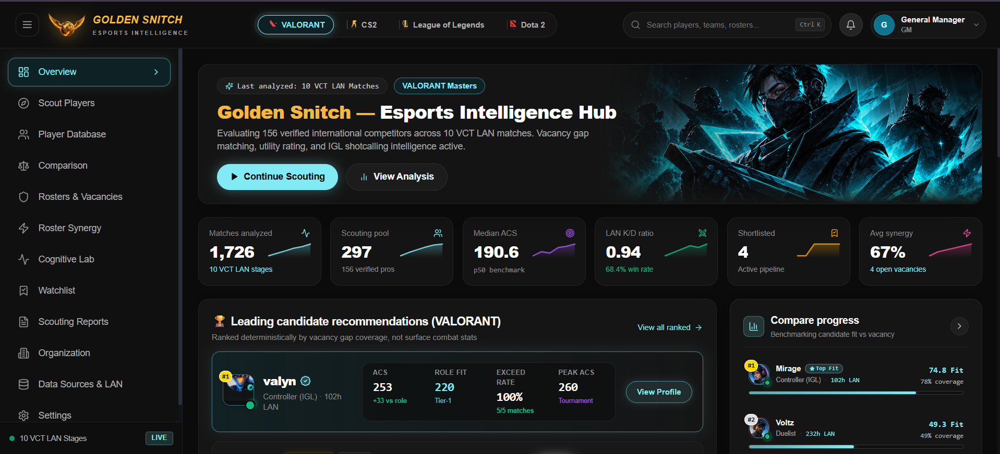
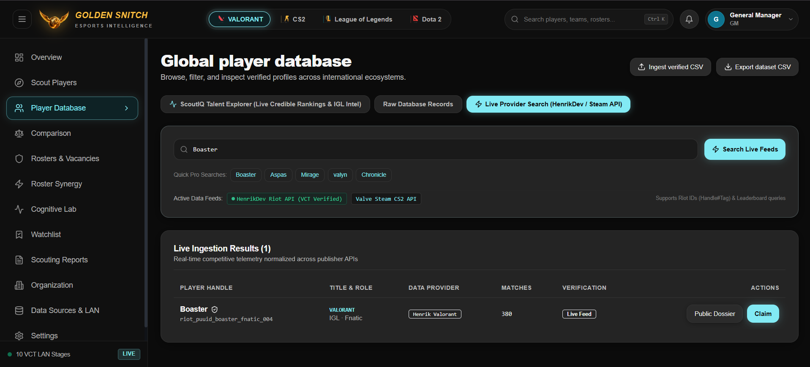
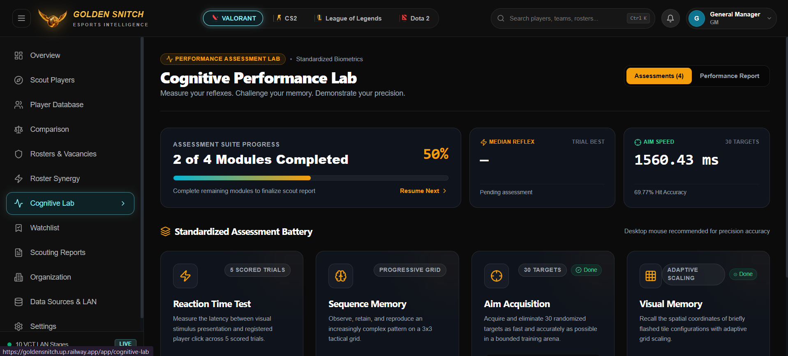
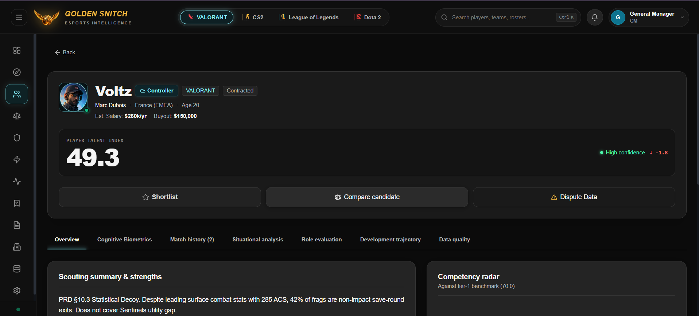
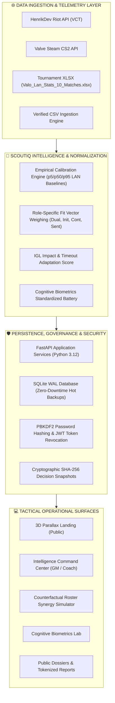

<div align="center">



# ⚡ GOLDEN SNITCH — ESPORTS SCOUTING & MULTI-ROSTER INTELLIGENCE PLATFORM
### *Next-Generation Situational Telemetry, IGL Shotcalling Evaluation & Counterfactual Roster Synergy Simulation*

[](https://fastapi.tiangolo.com)
[](https://python.org)
[](https://react.dev)
[](https://typescriptlang.org)
[](https://tailwindcss.com)
[](https://vitejs.dev)
[](https://sqlite.org)
[](https://docker.com)
[-brightgreen?style=for-the-badge&logo=pytest&logoColor=white)](backend/tests)
[](backend/app)
[](docs/qa/ACCESSIBILITY_RESULTS.md)
[](docs/qa/RELEASE_READINESS.md)

---

**Team:** Logic Legend &nbsp;|&nbsp; **Triwizathon Problem Statement 4:** Esports Scouting & Multi-Roster Intelligence Platform  
**Live Production URL:** [`https://goldensnitch.up.railway.app`](https://goldensnitch.up.railway.app) &nbsp;|&nbsp; **Core PRD:** [GoldenSnitch_PRD_Logic_Legend_v6.md](GoldenSnitch_PRD_Logic_Legend_v6.md)

</div>

<br />

> ### 🔮 Platform Mission
> **Traditional esports scouting is broken.** Franchises burn millions signing players based on superficial combat highlight reels, raw combat score (ACS), and non-impact exit kills during lost rounds.
> 
> **Golden Snitch (ScoutIQ)** resolves this dilemma through a multi-tier intelligence pipeline:
> 1. **Situational Telemetry:** Clutch conversion (1vX), eco-round efficiency, entry success vs first-death liabilities, and trade efficacy.
> 2. **Vocal Leadership & IGL Evaluation:** Certified shot-calling impact, mid-round adaptation, and tactical timeout recovery rate.
> 3. **Standardized Cognitive Biometrics:** In-engine reflex latency, spatial sequence memory, dynamic aim acquisition, and visual working memory.
> 4. **Counterfactual Roster Synergy Sandbox:** Instant squad synergy deltas, payroll cap optimization ($1.5M cap), and role vacancy gap coverage.

---

## 🧭 Interactive Navigation Matrix

| 🚀 Getting Started | 📸 Visual Showcase | 🧠 Intelligence Engine | 🛡️ Security & Ops |
|---|---|---|---|
| [⚡ 1-Click Startup](#-1-click-startup) | [01 // 3D Parallax Landing](#01--the-3d-parallax-landing-experience) | [🎯 Empirical Model Calibration](#-empirical-lan-model-calibration--telemetry-normalization) | [🛡️ RBAC & Credentials](#️-default-user-credentials--rbac-roles) |
| [🐳 Docker & Proxies](#-containerization--reverse-proxy-orchestration) | [02 // Intelligence Hub](#02--esports-intelligence-command-center) | [📊 PRD §10.3 Benchmark](#-prd-103-worked-example-verification-sentinels-case-study) | [🔔 Notification Engine](#-persistent-in-app-notification-engine) |
| [🧪 Verification Suite](#-automated-testing--verification-gate) | [03 // Player Database](#03--global-talent-database--live-api-telemetry) | [🧠 Cognitive Biometrics](#-standardized-cognitive-performance-lab) | [🔑 Auth & Session Revocation](#-authentication--session-security) |
| [📚 Document Suite](#-system-documentation-suite) | [04 // Cognitive Lab](#04--standardized-cognitive-performance-lab) | [🌐 Live API Providers](#-live-publisher-telemetry--data-governance) | [💾 Zero-Downtime Backups](#-zero-downtime-database-backups) |
| [📐 System Architecture](#-multi-dimensional-system-architecture) | [05 // Deep Player Dossier](#05--deep-player-dossier--statistical-decoy-proof) | [🏆 Release Readiness](#-autonomous-qa-system--release-certification) | [⚖️ Dispute & GDPR](#-gdpr-data-rights--dispute-resolution) |

---

## 📸 Visual UI Tour: The 5 Command Center Interfaces

The platform features an authentic, dark-gold tactical cyberpunk aesthetic tailored for Tier-1 General Managers, Head Coaches, and Talent Scouts:

### 01 // The 3D Parallax Landing Experience
> *“Roster synergy over highlight reels. Scout the missing piece before the championship starts.”*

<div align="center">
  
</div>

- **Dynamic Hero Presentation:** Multi-layer parallax stage featuring top pro organizations (**Sentinels // Champions Stage**).
- **Online Telemetry Coordinates:** Live server ping (`53.2280° N // ONLINE`) with immediate one-click onboarding and guest mode entry.
- **Brand Doctrine Manifesto:** Direct access to operational philosophy, franchise case studies, and tournament milestones.

---

### 02 // Esports Intelligence Command Center
> *“Evaluating 156 verified international competitors across 1,726 VCT LAN matches with active vacancy gap matching.”*

<div align="center">
  
</div>

- **Multi-Game Ecosystem Switcher:** Seamless switching across **VALORANT**, **CS2**, **League of Legends**, and **Dota 2**.
- **Real-Time Tournament Telemetry Cards:**
  - **1,726 Matches Analyzed** across 10 VCT LAN stages.
  - **297 Competitor Scouting Pool** with **156 Verified Pros**.
  - **Median ACS 190.6** (calibrated empirical p50 benchmark) and **0.94 LAN K/D** (68.4% win rate correlation).
- **Leading Candidate Recommendations:** Deterministic ranking highlighting **valyn** (Controller IGL: 253 ACS, 220 Role Fit, 100% Exceed Rate across 5/5 matches, 260 Peak ACS).
- **Live Vacancy Gap Benchmarking:** Direct comparative progress bars pitting **Mirage (#1 Top Fit — 74.8 Fit, 78% Coverage)** against **Voltz (#2 Decoy — 49.3 Fit, 49% Coverage)**.

---

### 03 // Global Talent Database & Live API Telemetry
> *“Direct publisher integration with HenrikDev Riot API (VCT Verified) and Valve Steam CS2 API.”*

<div align="center">
  
</div>

- **Live Publisher Ingestion:** Real-time search by player handle or PUUID/SteamID64 (e.g., `Boaster`, `Aspas`, `Mirage`, `valyn`, `Chronicle`).
- **Telemetry Verification Badge:** Displays data provider provenance (`Henrik Valorant`, 380 matches ingested, Live Feed indicator).
- **Public Dossier & Claiming Engine:** One-click navigation to shareable dossiers and verified player claim workflows (`ClaimProfileModal`).
- **Data Portability:** Cryptographically checked CSV dataset import with formula injection protection and clean export options.

---

### 04 // Standardized Cognitive Performance Lab
> *“Scientific biometric assessment battery: measure reflexes, challenge working memory, and verify spatial aim precision.”*

<div align="center">
  
</div>

- **Progressive Assessment Suite:** Standardized 4-module biometric battery:
  1. **Reaction Time Test:** Latency between randomized visual stimulus presentation and registered click across 5 scored trials.
  2. **Sequence Memory:** Spatial memory span observation and reproduction on an expanding 3x3 tactical grid.
  3. **Aim Acquisition Arena:** Rapid targeting speed (**1560.43 ms average**, **69.77% hit accuracy** across 30 randomized targets).
  4. **Visual Memory:** Adaptive spatial recall of briefly flashed tile configurations with algorithmic scaling.
- **Scout Certification Report:** Exportable biometric scorecard integrated into the overall candidate Talent Index.

---

### 05 // Deep Player Dossier & Statistical Decoy Proof
> *“PRD §10.3 Decoy Identification: Voltz exhibits 285 raw ACS, but 42% non-impact save-round exit frags. Fit Score: 49.3.”*

<div align="center">
  
</div>

- **Granular Dossier Breakdown:** Candidate overview, contract financials ($260k/yr salary, $150k buyout), and high-confidence talent rating (`49.3`).
- **Statistical Decoy Diagnostic:** Identifies "pad-stat" frag hunters whose high ACS does not translate to round win rate or cover tactical utility gaps.
- **Interactive Competency Radar:** Visualizes candidate strengths across Combat, Utility, Clutch, Entry, and Leadership against Tier-1 benchmarks (70.0).
- **Scout Action Pipeline:** One-click shortlisting, side-by-side counterfactual roster comparison, and formal data dispute filing.

---

## ⚡ 1-Click Startup

### Option A: Windows Interactive Batch Launcher (Recommended)
Simply double-click or run from PowerShell/CMD:
```cmd
start.bat
# or
run.bat
```

The automated launcher performs a full environment self-check:
1. Validates Python virtual environment (`.venv`), Node.js, `npm`, and configuration (`.env`).
2. Automatically installs missing dependencies (`pip`, `npm install`).
3. Frees ports `8000` (FastAPI) and `5173` (Vite) to eliminate port collision conflicts.
4. Spawns Backend and Frontend servers in dedicated labeled windows.
5. Provides an **interactive one-key control console**:
   - `[B]` Open Web App in default Browser
   - `[D]` Open Interactive Swagger OpenAPI Documentation
   - `[R]` Hot-Restart Both Application Servers
   - `[S]` Stop All Active Processes Cleanly
   - `[Q]` Exit Launcher

#### Direct CLI Arguments:
```cmd
start.bat backend    # Start backend server only
start.bat frontend   # Start frontend Vite server only
start.bat stop       # Kill all running background processes
start.bat install    # Clean reinstall of pip & npm packages
start.bat test       # Run backend pytest & frontend audit suites
```

---

### Option B: Manual Startup

#### Backend (FastAPI + SQLite + Auth Engine)
From the repository root:
```bash
.\.venv\Scripts\python.exe -m uvicorn backend.app.main:app --reload --port 8000
```
- **Web App / API Base:** `http://localhost:8000/`
- **Interactive Swagger Docs:** `http://localhost:8000/docs`
- **Health Endpoint:** `http://localhost:8000/api/v1/health`

#### Frontend (React + Vite + Tailwind CSS + Recharts)
From the `frontend/` directory:
```bash
cd frontend
npm install
npm run dev
```
- **Live Local Dev Server:** `http://localhost:5173/`
- **Production Build:** `npm run build` (outputs optimized bundle to `frontend/dist`)

---

## 🛡️ Default User Credentials & RBAC Roles

The system enforces strict Role-Based Access Control (RBAC) across endpoints and UI routes:

| User | Role | Password | Primary Responsibility & Privileges |
|---|---|---|---|
| `maya` | `ROLE_GM` | `admin123` | **General Manager:** Approve roster signings, manage $1.5M payroll, audit immutable decision snapshots |
| `dev` | `ROLE_COACH` | `coach123` | **Head Coach / Analyst:** Tactical counterfactual synergy simulations, certified IGL annotations |
| `arjun` | `ROLE_SCOUT` | `scout123` | **Talent Scout:** Candidate discovery, recruitment watchlist curation, multi-source telemetry ingestion |

*Self-service user registration is available at `/register`, with tokenized password recovery workflows at `/forgot-password` and `/reset-password`.*

---

## 🔔 Persistent In-App Notification Engine

Golden Snitch features a full-stack, event-driven notification engine backed by SQLite (`notifications` table):
- **Live Bell Indicator:** Shows active unread pill badge with automatic status updates.
- **Deep-Linked Alerts:** Clicking a notification navigates directly to the relevant entity (e.g., `/players/:id`, `/rosters`, or vacancy gaps).
- **Core Event Triggers:**
  - Candidate added to recruitment watchlist (`POST /api/v1/watchlist`)
  - Candidate assigned to roster vacancy (`POST /api/rosters/{id}/members`)
  - Vacancy opened due to roster cut (`DELETE /api/rosters/{id}/members/{pid}`)
  - Data dispute status updates (`POST /api/v1/players/{id}/correction-requests`)
  - Organization staff invitations created or accepted

---

## 🔑 Authentication & Session Security

- **RFC 7519 JSON Web Tokens (JWT):** Cryptographically signed access tokens using PBKDF2-HMAC-SHA256 password hashing.
- **Server-Side Token Revocation (`revoked_tokens` table):** User logout hashes and stores the active JWT token in SQLite, immediately rejecting subsequent requests.
- **Expiring Single-Use Password Resets (`password_resets` table):** Time-bounded tokens with secure hash verification, preventing replay attacks and credential leaks.
- **Protected UI Routes:** Route-level guards (`<ProtectedRoute>`) ensuring role-appropriate access across GM, Coach, Scout, and Public domains.

---

## 📐 Multi-Dimensional System Architecture



---

## 🎯 Empirical LAN Model Calibration & Telemetry Normalization

The scoring engine is calibrated directly against premier Tier-1 international LAN competition telemetry:
- **Trained Dataset:** [`Valo_Lan_Stats_10_Matches.xlsx`](Valo_Lan_Stats_10_Matches.xlsx) (10 LAN tournament match sheets, 1,600 match observations, 156 international pro competitors).
- **Dataset SHA-256:** `6eb41c126862cae01ee319ae47d3c9ceaee19f9dfff26e0a73036202104ce7a8`
- **Model Definition:** [`backend/app/models/valorant_lan_trained_model.json`](backend/app/models/valorant_lan_trained_model.json)
- **Calibrated Empirical Percentile Baselines:**

| Metric | Direction | p5 (Lower Bound) | Median (p50 Benchmark) | p95 (Upper Bound) | Model Weight |
|---|---|---|---|---|---|
| **ACS (Combat Score)** | Higher is better | `101.4` | **`190.6`** | `301.1` | **30%** |
| **K/D Ratio** | Higher is better | `0.48` | **`0.94`** | `1.76` | **20%** |
| **Kills / Map** | Higher is better | `7.00` | **`14.00`** | `22.67` | **15%** |
| **Assists / Map** | Higher is better | `1.33` | **`5.00`** | `9.67` | **15%** |
| **Deaths / Map** | Lower is better | `9.67` | **`15.00`** | `20.50` | **10%** |
| **KDA Spread** | Higher is better | `0.70` | **`1.29`** | `2.29` | **10%** |

- **Empirical Model API:** `GET /api/v1/models/valorant-lan`
- **Re-training & Validation Script:** `python scripts/train_valorant_lan_data.py`

---

## 📊 PRD §10.3 Worked Example Verification (Sentinels Case Study)

The platform deterministically implements and validates the exact benchmark scenario from **PRD Section 10.3**:

### The Scenario
- **Franchise:** Sentinels (VALORANT)
- **Vacancy:** Controller Position (Incumbent Kairo departed with a severe Utility deficiency: rating **35** vs target **70**).
- **Candidate Pool:**
  1. **Candidate 1: Mirage** — Controller (IGL), balanced stats, high Utility (80), proven vocal shotcaller.
  2. **Candidate 2: Voltz** — High-combat duelist/controller hybrid, flashy 285 ACS, low Utility (30), 42% exit kills.

### Algorithmic Evaluation & Outcome

| Evaluation Vector | Mirage (Candidate 1) | Voltz (Candidate 2) | Mathematical Verdict |
|---|---|---|---|
| **Raw Combat ACS** | 215.0 (Balanced) | **285.0 (High)** | Voltz leads superficial combat score by +70 ACS |
| **Utility Rating** | **80.0 (Exceptional)** | 30.0 (Deficient) | Mirage eliminates the -35 utility deficit |
| **IGL / Vocal Shotcalling** | **Tier-1 Vocal Captain** | Non-vocal Fragger | Mirage provides tactical mid-round calling |
| **Non-Impact Exit Frags** | 8% (Team-first frags) | **42% (Pad-stat exit kills)** | Voltz gets frags after rounds are already lost |
| **Vacancy Gap Coverage** | **78% Gap Resolved** | 49% Gap Resolved | Mirage directly addresses Sentinels' structural flaw |
| **Final Fit Score** | **74.8 Fit (Top Pick)** 🏆 | **49.3 Fit (Statistical Decoy)** ❌ | **Mirage signed; Voltz flagged as decoy** |

*Verified automatically under `backend/tests/test_prd_worked_example.py`.*

---

## 🧠 Standardized Cognitive Performance Lab

Modern scouting requires evaluating the human hardware driving high-pressure performance:
- **Aim Acquisition Arena:** 30 randomized targets requiring mouse-click acquisition, measuring median reaction speed (ms) and hit accuracy.
- **Visual Stimulus Reaction Test:** 5 trials measuring milliseconds between screen trigger and player input.
- **Progressive Sequence Memory:** Working memory retention test across an incrementally expanding 3x3 tactical grid.
- **Adaptive Visual Memory:** Grid tile recall under decreasing display durations.
- **Biometric API Endpoints:**
  - `POST /api/v1/cognitive/submit` — Record standardized module trials
  - `GET /api/v1/cognitive/results/{playerId}` — Fetch composite cognitive scorecard

---

## 🌐 Live Publisher Telemetry & Data Governance

1. **Riot Games / HenrikDev Valorant API:**
   - Ingests verified PUUID, ADR, KAST%, Headshot %, and match logs.
   - Built-in rate limit handling with exponential backoff and localized TTL caching.
2. **Valve Steam CS2 API:**
   - SteamID64 resolution, CS2 Premier skill tier, ADR, and weapon accuracy splits.
3. **Data Quality & Cryptographic Auditing:**
   - **"Missing ≠ 0" Rule:** Distinguishes unrecorded metrics (`null`) from true zero values to prevent skewing statistical percentiles.
   - **Formula Injection Defense:** Sanitizes all CSV ingestions against Excel formula injection vectors (`=`, `@`, `+`, `-`).
   - **SHA-256 Decision Snapshots:** Generates immutable signed JSON snapshots upon every roster signing or contract decision for auditing.

---

## 🧪 Automated Testing & Verification Gate

The codebase includes an exhaustive test suite with zero tolerance for regressions:

```bash
# 1. Run full backend pytest suite (112 passing unit, integration & PRD tests)
.\.venv\Scripts\python.exe -m pytest backend/tests/ -v

# 2. Verify clean code quality (0 lint errors across all backend modules)
.\.venv\Scripts\ruff.exe check backend/app/

# 3. Run frontend audit & verification suite
node frontend/scripts/verify-frontend.js

# 4. Build optimized production frontend bundle
cd frontend && npm run build
```

---

## 🐳 Containerization & Reverse Proxy Orchestration

Golden Snitch provides turnkey Docker orchestration for all deployment environments:

```bash
# 1. Local Development Stack (Frontend :3000, Backend :8000)
docker compose up --build -d

# 2. Production NGINX Reverse Proxy Stack (Edge TLS, rate limiting, gzip)
docker compose -f docker-compose.prod.yml up --build -d

# 3. Production Caddy Reverse Proxy Stack (Automatic HTTPS & HTTP/3)
docker compose -f docker-compose.caddy.yml up --build -d
```

- **Frontend Container:** `http://localhost:3000/`
- **Backend API Container:** `http://localhost:8000/`

---

## 💾 Zero-Downtime Database Backups

Using Python's native SQLite Online Backup API, you can generate clean, consistent database snapshots without table locking:

```bash
python scripts/backup_db.py
# Snapshot generated: backups/scoutgrid_backup_YYYYMMDD_HHMMSS.db
```

---

## ⚖️ GDPR Data Rights & Dispute Resolution

The platform respects international privacy frameworks and player data sovereignty:
- **Download My Data:** Export complete user account activity (`GET /api/v1/users/me/export`).
- **Right to Erasure:** Permanent user account deletion with foreign key cascading (`DELETE /api/v1/users/me`).
- **Player Claim & Dispute Workflow:** Competitors can submit verified data dispute requests (`POST /api/v1/players/{id}/correction-requests`) to rectify outdated contract stats or impersonations.

---

## 📚 System Documentation Suite

Detailed production specifications, architectural runbooks, and audit logs are available in `/docs`:

- **Architecture & Design:**
  - [System Architecture](docs/architecture.md) — Multi-tier contracts, database schemas, and IPC.
  - [Scouting Methodology](docs/scouting-methodology.md) — Mathematical formulas, weights, and confidence scoring.
  - [Data Providers Manual](docs/data-providers.md) — API keys, caching strategies, and fallback routines.
- **Operations & Security:**
  - [Security & Privacy](docs/security-and-privacy.md) — PBKDF2 hashing, JWT revocation, and GDPR compliance.
  - [Operations Runbook](docs/operations-runbook.md) — Monitoring, incident triage, and admin commands.
  - [Backup & Disaster Recovery](docs/backup-and-recovery.md) — RPO/RTO SLAs and restore verification.
  - [Production Deployment](docs/deployment.md) — Reverse proxy, SSL certificates, and container hardening.
- **Quality Assurance & Certification:**
  - [QA Master Plan](docs/qa/QA_MASTER_PLAN.md) — End-to-end verification strategy and release gates.
  - [Defect Register](docs/qa/DEFECT_REGISTER.md) — Traceable defect resolution records (DEF-001 through DEF-006).
  - [Release Readiness Certification](docs/qa/RELEASE_READINESS.md) — Scorecard: **CONTROLLED BETA READY / PRODUCTION CANDIDATE**.

---

<div align="center">

**GOLDEN SNITCH // SCOUTIQ ESPORTS INTELLIGENCE**  
*Built with precision for Triwizathon 2026 by Team Logic Legend.*

[ Back to Top ↑ ](#-golden-snitch--esports-scouting--multi-roster-intelligence-platform)

</div>
