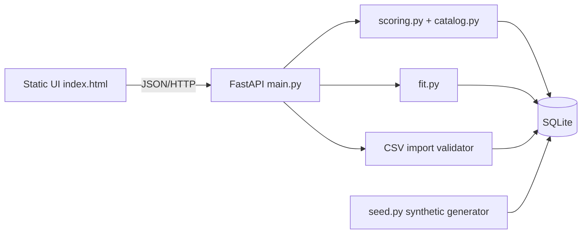
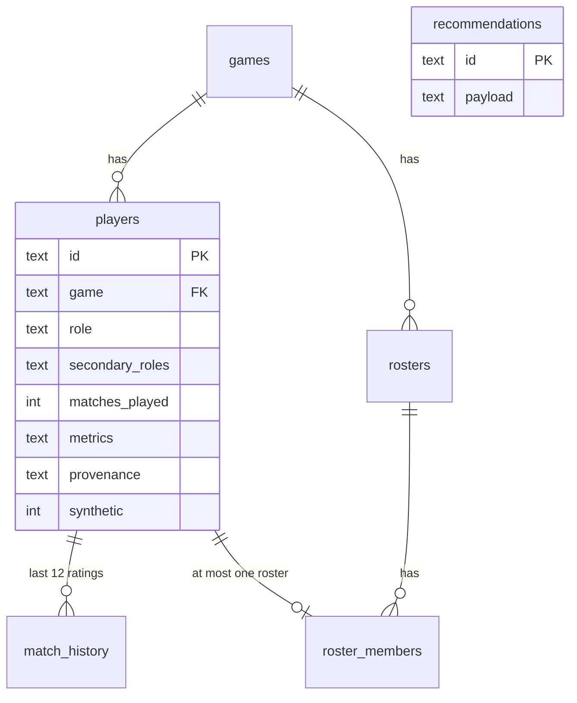

# System architecture (ARC-001) and data model (DATA-001)
**Stack:** FastAPI + SQLite (stdlib `sqlite3`) + pure-Python scoring; static HTML/JS UI served by the same process. Deviation from the preferred React/Vite/TypeScript stack is deliberate (ADR-1): no build step means fewer failure points in 24 h. pandas/NumPy were not needed for ≤1,000 rows.

**Responsibilities.** UI: render state, call API, no scoring logic. API: validation, error envelope, persistence, orchestration. `catalog.py`: single source of truth for games, dimensions, weights, ranges. `scoring.py`: normalisation, evidence, ranking, explanations. `fit.py`: roster state, gaps, fit. `db.py`: schema + loader. Import adapter boundary: `POST /api/players/import` is the only ingestion entry; a future public-API adapter would produce the same row dicts.

**Request lifecycle (recommendation).** UI posts `{roster_id, role}` → validate roster/role/weights (422 on failure) → load all players of the roster's game → eligible pool = primary-or-secondary role → build sorted metric index over the pool → candidates = free agents in pool → per candidate: percentiles → dimension scores → weighted base score (renormalised over available dimensions) → evidence index → fit → deterministic sort `(ranked first, score↓, evidence↓, player_id↑)` → explanations from computed numbers → persist JSON → respond.

**Errors.** `{"error":{"code","message","details"}}`; handlers for ApiError, request validation (422) and unexpected exceptions (500, no trace). **Config.** `SCOUTGRID_DB` path. **Deployment.** single `uvicorn` process (see runbook).

**Tables:** `games(code PK,name)`; `players(id PK, name, game FK, role, secondary_roles JSON, matches_played ≥0, metrics JSON, provenance JSON, synthetic, source, UNIQUE(game,name))`; `match_history(player_id FK, idx, rating, PK(player_id,idx))`; `rosters(id PK, name UNIQUE, game FK)`; `roster_members(roster_id FK, player_id FK UNIQUE, slot_role, PK(roster_id,player_id))`; `recommendations(id PK, payload JSON, created_at)`.
**Simplifications vs the PRD entity list:** `PlayerRole` = `players.role/secondary_roles`; `EvaluationWeights` live in `catalog.py` and may be overridden per request (stored inside the recommendation payload); `RecruitmentRequirement`/`ScoutingShortlist` are P1.
**Cross-game isolation.** Metrics are JSON keyed by each title's own names (`kill_death_ratio` vs `kda`); `DIMENSIONS[game]` maps shared skill dimensions to title-specific metrics. Percentiles are computed only inside one game's pool; compare/membership across games is rejected (TEST-004).

## ADRs
| ID | Decision | Reason | Revisit when |
|---|---|---|---|
| ADR-1 | Static UI instead of React/Vite | no toolchain risk | UI grows beyond ~5 views |
| ADR-2 | SQLite + JSON metric columns | flexible per-title metrics, zero ops | multi-user or >100k rows → PostgreSQL + EAV/typed tables |
| ADR-3 | Percentile (mid-rank) normalisation | robust to outliers, no tuning | pools <8 (flagged) |
| ADR-4 | Missing dimension ⇒ renormalise weights, report coverage separately | no hidden penalty | stakeholders want penalties |
| ADR-5 | No LLM in scoring | determinism, no cost | optional narrative text later (P2) |
