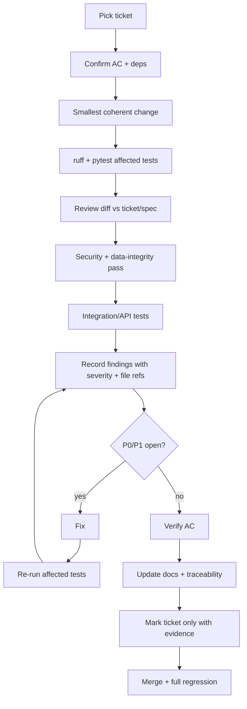

# Code review loop

Rules: a green build is not proof of correctness; reproduce each finding or document why it is a false positive; never mark TESTED without an executed test; update `REVIEW_FINDINGS_*.md` each round. Quick command: `scripts/quality_gate.sh`.
