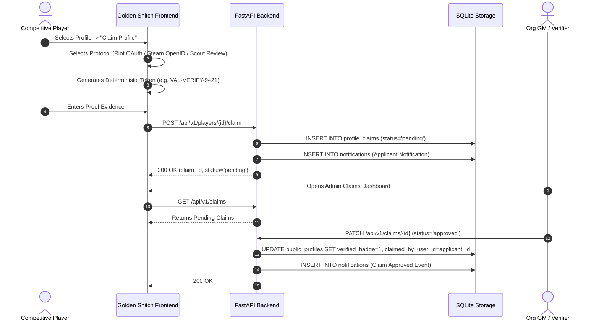

# Player Identity Resolution, Claiming & Verification Protocols

## 1. Identity Resolution Architecture
In professional esports, gamer handles change frequently and collisions are common. Golden Snitch guarantees deterministic identity resolution via immutable external identifiers:

```
[ Internal Player Record ]
      |
      +---> `player_id`: "VAL-002"
      |
      +---> `public_slug`: "mirage"
      |
      +---> `player_identities` (1:N)
             |-- Provider: "henrik_valorant", ID: "riot_puuid_mirage_sentinels_002"
             +-- Provider: "steam_cs2",        ID: "76561198012345678"
```

### Identifier Hierarchy
1. **Riot PUUID / SteamID64 (Cryptographic Primary):** Unique across handle changes and region migrations.
2. **Handle#Tagline (Display Level):** Current public identifier subject to cosmetic modification.
3. **Internal UUID:** Persistent database primary key guaranteeing relational stability.

---

## 2. Profile Claim Workflow



### Verification Methods
1. **Riot Games OAuth / PUUID Verification:** Verifies account control by matching the authenticated Riot token against the player's PUUID.
2. **Steam OpenID Token Matching:** Verifies Counter-Strike account ownership via Valve OpenID 2.0 handshake.
3. **Manual Scout Review with Code Proof:** For tournament players, places a randomized token (e.g., `VAL-VERIFY-8821`) on their public Twitter/X or tracker profile, audited by an organization GM or scout.
